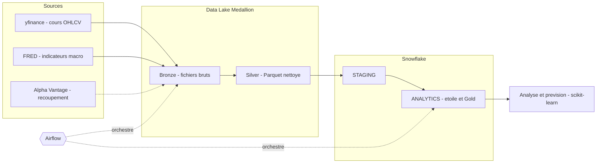
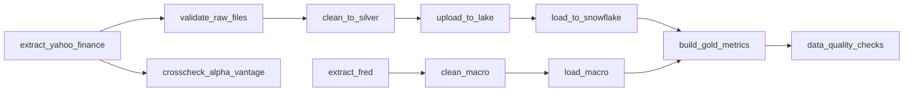
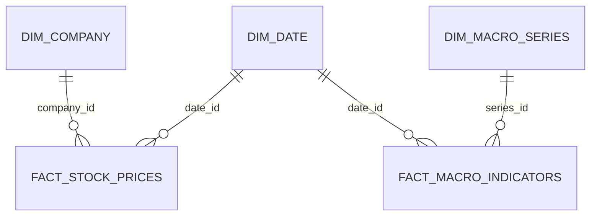
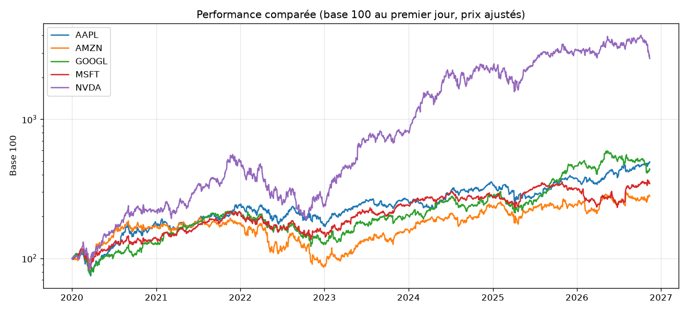
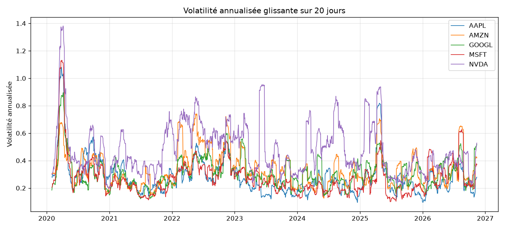

# Financial Data Engineering Platform


Plateforme de données financières de bout en bout : collecte de cours boursiers et d'indicateurs macroéconomiques, Data Lake (architecture Medallion), orchestration Airflow, entrepôt Snowflake en modèle en étoile, contrôles qualité et expérimentation de modèles de prévision.

> **English summary.** End-to-end data engineering project: stock prices (yfinance) and macro indicators (FRED) are ingested with Python, stored in a Bronze/Silver data lake, orchestrated with Airflow (Docker), loaded into a Snowflake star schema, transformed with SQL (ELT) and checked by automated data quality tests. A machine learning module compares forecasting models against simple baselines, with strict temporal splits to avoid data leakage.

**Avertissement :** projet pédagogique. Les analyses et prévisions décrivent le passé et ne constituent pas un conseil financier.

## Architecture



| Brique | Rôle |
|---|---|
| Python, pandas, PyArrow | Ingestion, nettoyage, export Parquet |
| Data Lake Medallion (Bronze, Silver) | Brut conservé tel quel, puis données validées et typées |
| Apache Airflow 3 (Docker) | Orchestration, retries, dépendances, suivi |
| Snowflake | Entrepôt, modèle en étoile, transformations SQL (ELT) |
| scikit-learn | Analyse de la volatilité et prévision avec modèles de référence |
| Docker, GitHub Actions | Environnement reproductible, tests automatiques |

## Le pipeline Airflow



Deux branches parallèles (cours et macro) convergent vers la couche Gold, qui n'est construite que si les deux ont réussi. Les tests de qualité font échouer le run si un contrôle bloquant échoue.

## Sources de données

| Source | Contenu | Accès et limites |
|---|---|---|
| yfinance | Cours journaliers de AAPL, MSFT, NVDA, AMZN, GOOGL (depuis 2020) | Gratuit, non officiel : peut changer sans préavis |
| FRED | Taux directeur, inflation, rendement à 10 ans, chômage, VIX | Clé gratuite, environ 120 requêtes par minute. Plan B : export CSV public |
| Alpha Vantage | Recoupement des cours sur 100 jours | Clé gratuite : 25 requêtes par jour. Les fiches d'entreprise (OVERVIEW) sont refusées sur clé gratuite, l'historique complet est payant |

**Recoupement des sources :** sur les 100 derniers jours, aucun écart de clôture supérieur à 0,5 % entre yfinance et Alpha Vantage.

## Modèle de données (Snowflake)



- **Faits :** `FACT_STOCK_PRICES` (une ligne par entreprise et par jour de bourse, 8 635 lignes), `FACT_MACRO_INDICATORS` (3 720 observations).
- **Gold :** `FACT_DAILY_METRICS` (rendements, moyennes mobiles, volatilité, drawdown), `AGG_COMPANY_PERFORMANCE` (synthèse par entreprise), `GOLD_MARKET_MACRO` (cours et indicateurs macro tels que connus à chaque date).
- Les clés primaires et étrangères sont déclarées mais non appliquées par Snowflake : l'unicité est garantie par le pipeline (`MERGE`) et vérifiée par les contrôles qualité.

## Décisions d'architecture

| Décision | Pourquoi | Alternatives |
|---|---|---|
| Bronze conservé sans modification | Rejouer le nettoyage si une règle contient un bug, auditabilité | Nettoyer dès l'ingestion (perd la source) |
| Silver en Parquet | Colonnaire, typé et compressé : 386 Ko contre 964 Ko en CSV | CSV, Delta Lake |
| Chargement par `MERGE` | Idempotent : relancer un run ne crée pas de doublon | `INSERT` après `TRUNCATE` |
| Transformations Gold en SQL dans Snowflake (ELT) | Fonctions de fenêtre, calcul là où sont les données | dbt (tests et lignage intégrés) |
| Rôle dédié `FIN_ENGINEER`, budget `RESOURCE MONITOR` | Moindre privilège, maîtrise des coûts | Rôle administrateur pour tout |
| Jointure temporelle des séries macro avec délai de disponibilité | Évite la fuite d'information : une valeur mensuelle n'est utilisée qu'après sa publication supposée | Jointure sur la date d'observation |
| Découpage temporel avec écart, comparaison à des modèles de référence | Évalue sans fuite d'information et sans surestimer les modèles | Découpage aléatoire (interdit en séries temporelles) |
| Docker pour l'exécution | Environnement identique pour tout le monde | Environnement virtuel local |

## Qualité des données

- **Nettoyage Silver :** types, valeurs manquantes, doublons, valeurs impossibles, barre du jour incomplète exclue, chaque règle comptée dans les logs.
- **Validation Bronze dans Airflow :** fichiers présents, non vides, récents.
- **Contrôles SQL après chargement :** doublons, prix invalides, clés orphelines, cohérence du nombre de lignes, fraîcheur des données. Les rendements extrêmes (plus de 20 % en un jour) sont signalés sans bloquer, car ils peuvent être réels.
- **Tests unitaires :** règles de nettoyage et absence de fuite d'information dans les variables de prévision.

## Machine learning

**Méthodologie.** Cibles : volatilité des 5 jours suivants (régression) et direction du lendemain (classification). Variables calculées uniquement à partir du passé. Découpage par date avec un écart égal à l'horizon de prévision. Chaque modèle est comparé à une règle simple de référence.

**Analyses (couche Gold) :**




**Résultats de la prévision :**

<!-- À COMPLÉTER avec les tableaux de ml/outputs/forecast_*_results.csv : meilleur modèle de volatilité
     et gain face à la référence ; ROC AUC des modèles de direction face au hasard (0,5).
     Conclusion honnête attendue : un petit gain sur la volatilité, presque aucun sur la direction. -->

## Démarrer

Prérequis : Docker Desktop, Git. Les clés API sont gratuites (FRED, Alpha Vantage), le compte Snowflake est un essai.

```powershell
git clone https://github.com/HibaSoubai/financial-data-platform.git
cd financial-data-platform
copy .env.example .env      # puis renseigner les valeurs dans .env (jamais de guillemets)
docker build -t fin-platform .
```

Pipeline étape par étape (sous bash, remplacer `${PWD}` par `$(pwd)`) :

```powershell
docker run --rm -v "${PWD}:/app" --env-file .env fin-platform python ingestion/yahoo_finance.py
docker run --rm -v "${PWD}:/app" --env-file .env fin-platform python transformations/cleaning.py
docker run --rm -v "${PWD}:/app" --env-file .env fin-platform python warehouse/load_to_snowflake.py
docker run --rm -v "${PWD}:/app" --env-file .env fin-platform python warehouse/run_sql.py gold
docker run --rm -v "${PWD}:/app" --env-file .env fin-platform python warehouse/run_sql.py quality
```

Les scripts SQL de création (rôles, schémas, tables) sont dans `snowflake/` et s'exécutent dans l'ordre : `database.sql`, `schemas.sql`, `tables.sql`, `macro_tables.sql`.

Orchestration complète avec Airflow (interface sur http://localhost:8080) :

```powershell
docker compose up airflow-init
docker compose up -d
```

Tests : `docker run --rm -v "${PWD}:/app" fin-platform python -m pytest tests -v`

## Structure du dépôt

```
financial-data-platform/
├── ingestion/        yahoo_finance.py, fred_api.py, alpha_vantage.py, compare_sources.py
├── transformations/  cleaning.py, macro_cleaning.py
├── datalake/         upload_to_adls.py (lac local, ou Azure ADLS Gen2)
├── warehouse/        load_to_snowflake.py, load_macro.py, run_sql.py
├── snowflake/        database.sql, schemas.sql, tables.sql, macro_tables.sql,
│                     gold_metrics.sql, quality_checks.sql, roles_bi.sql
├── ml/               volatility_analysis.py, price_forecasting.py
├── airflow/dags/     financial_pipeline.py
├── tests/            nettoyage, séries macro, anti-fuite d'information
├── .github/workflows/tests.yml
├── docker-compose.yaml, Dockerfile, requirements*.txt, .env.example
└── README.md
```

## Limites et suite

- **Cloud Azure :** le script d'envoi vers Azure Data Lake Storage Gen2 est écrit mais n'a pas été testé sur un compte réel. Le lac fonctionne en mode local.
- **Tableau de bord :** non réalisé. Un rôle Snowflake en lecture seule (`FIN_BI_READER`) est prêt pour un outil de BI (Power BI, Metabase).
- **Sources :** yfinance n'est pas une API officielle, et le compte gratuit d'Alpha Vantage est limité.
- **Secrets :** les identifiants sont dans `.env`, ignoré par Git. En production : gestionnaire de secrets et authentification par paire de clés ou identité managée.
- **Prévision :** expérience pédagogique. Les modèles décrivent des relations historiques, sans garantie sur l'avenir.